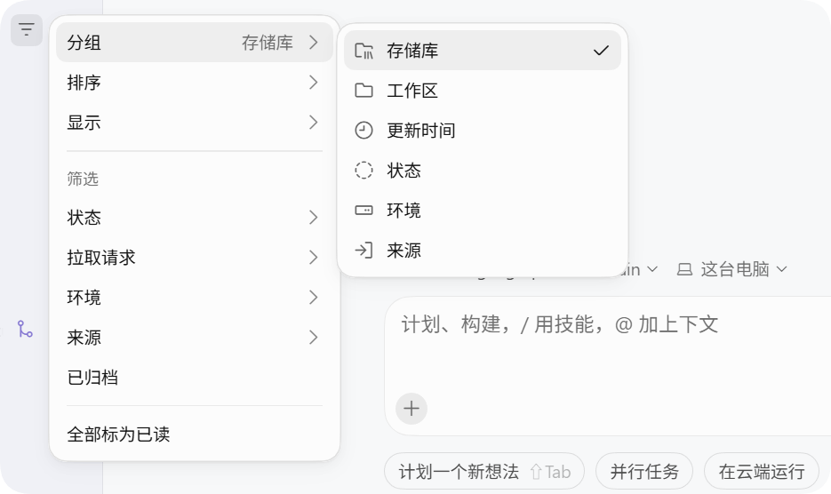

# Cursor Language Pack

Chinese translations for Cursor, including the editor, Settings and Agent interface. Supports Simplified Chinese and Traditional Chinese with Taiwan terminology.

[简体中文](../README.md)

<p>
  
  <a href="https://open-vsx.org/extension/polang233/cursor-language-pack"></a>
</p>

| Settings in Simplified Chinese | Settings in English |
| --- | --- |
|  |  |



## Command-line installation

Node.js 22+ is recommended; the minimum is 18.17. Quit Cursor completely first.

```bash
npx @polang233/cursor-language-pack@latest
```

The default command is `install`. It installs the language pack and translates text in the app files. Each npm version includes its matching VSIX, so users do not need to download or build the source. To switch languages or specify the install directory:

```bash
npx @polang233/cursor-language-pack@latest --locale=zh-cn
npx @polang233/cursor-language-pack@latest --locale=zh-tw
npx @polang233/cursor-language-pack@latest --dir="path/to/install"
```

| Subcommand | Purpose |
| --- | --- |
| `preview` | Preview changes |
| `status` | Report the current state |
| `restore` | Restore only the app files |

System locales with TW/HK/MO or zh-Hant select `zh-tw` with Taiwan terminology; all others select `zh-cn`. Override this with `--locale`. `--dir` selects the install directory containing `resources/app`, or `Cursor.app/Contents` on macOS.

Reopen Cursor after installation. Rerun the install command after an app update. Switch extensions and display language inside the app; `restore` does not uninstall the extension or reset the display language.

Test the source entry point from the repository. See [npm maintenance](npm.md) for preparation:

```bash
node bin/cli.mjs preview --locale=zh-tw
```

## Extension installation

1. Uninstall other language packs to avoid conflicts with the official VS Code Chinese packs.
2. Search Extensions for **Cursor Language Pack** or **汉化**, or download a VSIX from [GitHub Releases](https://github.com/polang233/cursor-language-pack/releases) and use **Extensions: Install from VSIX…**.
3. Run **Language Pack: Select Display Language**, choose Simplified or Traditional Chinese, then quit Cursor completely and reopen it.

The extension id remains `polang233.cursor-language-pack`. The setting `cursorLanguagePack.language` also accepts `auto`, `zh-cn`, `zh-tw` and `en`; restart after changing it. Translating some text compiled into the app requires the command-line installation above.

The translations target Cursor **3.27.22**. New or untranslated text stays in English. Names such as Cursor and MCP stay in English.

## Development and license

[Maintenance and source tests](npm.md) · [Publishing](publishing.md) · [Architecture](architecture.md) · [Contributing](CONTRIBUTING.md)

MIT. Workbench translations come from [microsoft/vscode-loc](https://github.com/microsoft/vscode-loc); see [NOTICE](../NOTICE). A community project, unaffiliated with Anysphere or Microsoft.
